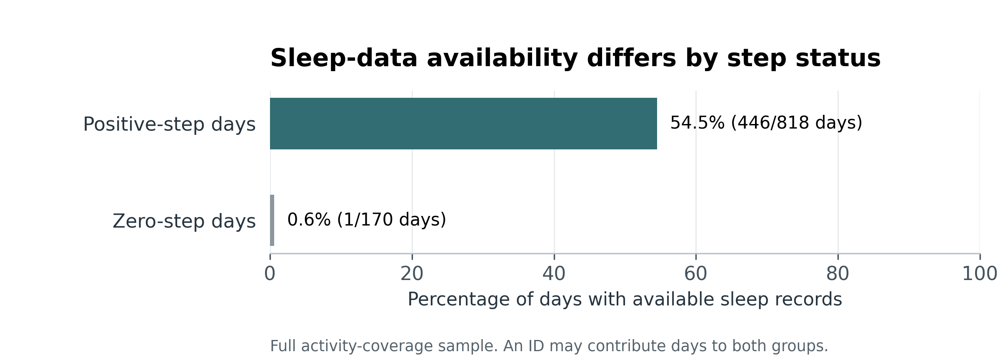

# Francis Amankwaa · Data analytics portfolio

I'm a nurse and research assistant based in Ghana, with a BSc in Nursing from Kwame Nkrumah University of Science and Technology. This portfolio documents my growing analytics practice and my interest in using data to answer useful questions.

## Featured project

### [Bellabeat Leaf: activity, recorded sleep and data availability](projects/bellabeat/README.md)

A Google Data Analytics capstone using historical Fitbit exports to develop marketing hypotheses for Bellabeat. I prepared one daily table from 11 source files, checked recording coverage in BigQuery, compared weighting methods and examined the effect of zero-step records.

- **Main activity sample:** 988 daily records from 33 distinct IDs.
- **Sensitivity finding:** mean steps changed from 6,889.7 to 8,321.5 when zero-step days were excluded.
- **Sleep-data selection:** sleep records were present on 54.5% of positive-step days and 0.6% of zero-step days.
- **Business output:** four testable recommendations, with explicit limits on what this historical sample can support.

[Read the report](projects/bellabeat/reports/Bellabeat_Case_Study.pdf) · [Inspect the SQL](projects/bellabeat/sql/) · [Review aggregate results](projects/bellabeat/results/)

## Tools and methods

GoogleSQL / BigQuery · data preparation · recording-coverage checks · descriptive analysis · sensitivity analysis · data visualisation · research methods.

Python scripts document the preparation and figure-generation workflow. The portfolio website uses plain HTML, CSS and JavaScript, with no build step or third-party tracking.

## Repository contents

| Path | Contents |
| --- | --- |
| `index.html`, `styles.css`, `script.js` | Portfolio home page and shared presentation |
| `projects/bellabeat/index.html` | Web version of the case study |
| `projects/bellabeat/sql/` | Data checks, activity analysis and sleep analysis |
| `projects/bellabeat/results/` | Aggregate results used in the report |
| `projects/bellabeat/charts/` | PNG and SVG figures |
| `projects/bellabeat/code/` | Data preparation and reproduction scripts |
| `projects/bellabeat/reports/` | Full PDF report |

This public edition contains aggregate results. Row-level health records and ID-level profiles are not included. The PDF also describes the original working project bundle; the public repository has the narrower contents listed above.

For publishing instructions, see [GitHub Pages setup](GITHUB_PAGES_SETUP.md).

© 2026 Francis Amankwaa. Data and third-party materials retain their original attribution; see the case-study sources.
