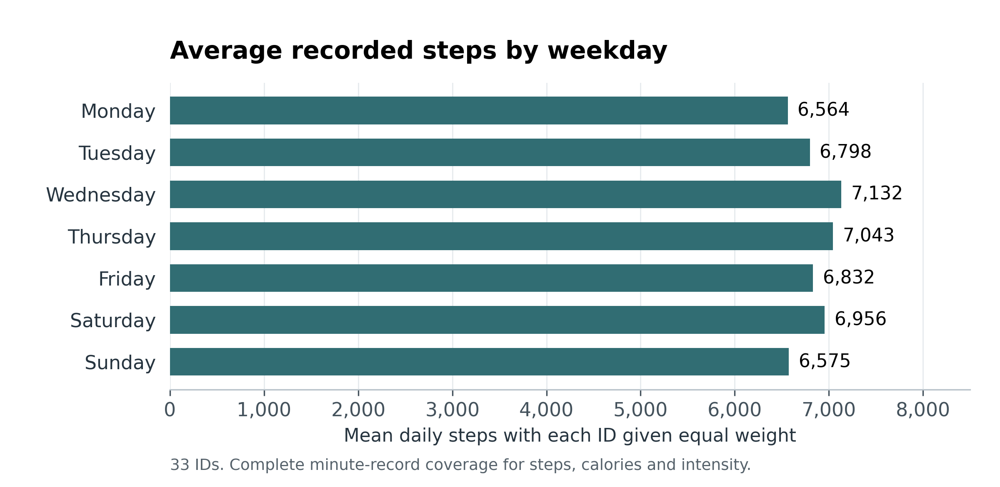
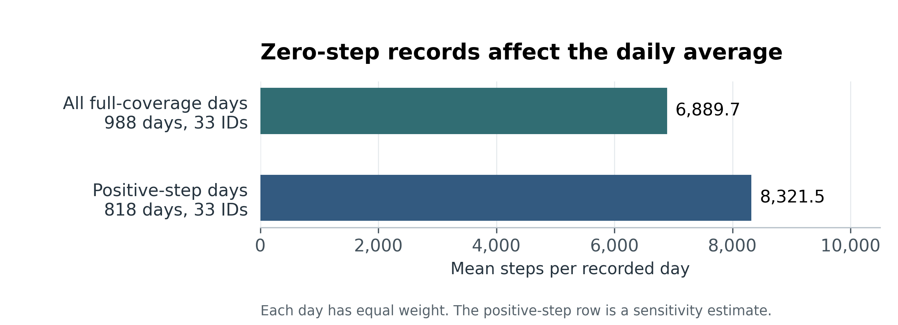
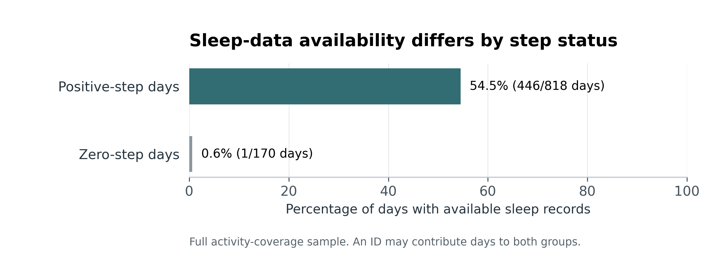
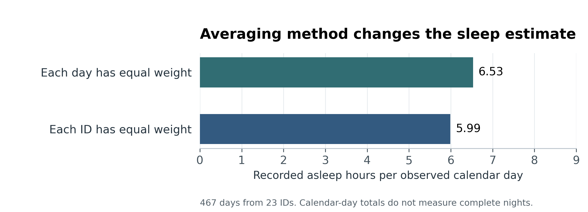

# Bellabeat Leaf: activity, recorded sleep and data availability

**Francis Amankwaa · Google Data Analytics capstone · November 2026**

[Full report (PDF)](reports/Bellabeat_Case_Study.pdf) · [SQL](sql/) · [Aggregate results](results/) · [Analysis files (ZIP)](downloads/Bellabeat_Analysis_Files.zip)

## Business task

Explore historical smart-device records and develop marketing hypotheses for the Bellabeat Leaf tracker and companion app. The analysis asks what activity and sleep patterns appear, how data availability affects their interpretation, and what Bellabeat could test with its own customers.

## Data preparation

I aggregated each of the 11 supplied Fitbit export files by ID and calendar date before joining them. The merged table has 1,060 records, 54 fields and 35 distinct IDs, spanning 11 March to 12 April 2016. I removed 525 exact duplicate sleep rows, preserved missing measurements and kept overlapping source totals in separate fields.

The main activity sample requires 1,440 minute records in each of the step, calorie and intensity streams. That leaves 988 dates from 33 IDs, spanning 12 March to 11 April 2016. Complete exported records do not establish complete device wear.

The source description mentions 30 consenting users, while the supplied files contain 35 IDs. This discrepancy is unresolved; IDs are analytical units rather than verified individual people.

## Main findings

| Finding | Result | Interpretation |
| --- | --- | --- |
| Daily steps | Mean 6,889.7; median 6,419 | 988 complete-coverage daily records |
| Weighting sensitivity | Equal-ID mean 6,836.3 steps | The activity mean changes little when every ID has equal weight |
| Zero-step sensitivity | 170 zero-step days (17.2%); positive-only mean 8,321.5 | A 20.8% change; the reason for zero steps is unknown |
| Recorded active minutes | Approximately 85% were light activity | A basis for testing everyday-movement messaging |
| Weekday/weekend comparison | 6,870.5 vs 6,769.7 steps | Paired difference of 100.8 steps; about 1.5% |
| Sleep availability | 467 days from 23 IDs across the merged table | 44.1% of available daily records |
| Sleep by step status | 54.5% of positive-step days; 0.6% of zero-step days | Matched sleep records are a selected subset |
| Recorded asleep hours | 6.53 daily-record weighted; 5.99 equal-ID weighted | Calendar-day totals, not complete-night durations |
| Same-day step–sleep correlation | −0.113 on 447 matched days | Weak descriptive association; no causal conclusion |









## Recommendations to test

1. **Everyday-movement messaging:** compare achievable daily movement with a generic product message; measure purchases per assigned visitor.
2. **Tracking guidance at onboarding:** test a setup and syncing guide; measure recording availability using criteria appropriate to Leaf's actual data stream.
3. **Personalised progress summaries:** test valid personal baselines and chosen goals; measure app return rate at 28 days.
4. **Clearer sleep summaries:** test an explanation of recorded sleep; measure whether eligible users view the summary within 14 days.

These are proposed experiments. The dataset contains no campaign, purchase or subscription outcomes.

## Limitations

The data are historical, small and self-selected. Gender and Bellabeat customer status are not established. Zero-step records do not prove inactivity or non-wear. Sleep coverage is uneven, and calendar-day aggregation does not preserve whole nights. Repeated days within an ID are not independent participants. No population estimates, statistical significance or causal effects are claimed.

## Reproduce the workflow

The public edition includes SQL, aggregate tables, charts and code. It excludes the prepared row-level CSV and ID-level health profiles. Reproduction requires the corresponding original March–April 2016 public Fitbit exports; other export periods will give different results.

Install the script dependencies in a Python environment:

```sh
python -m pip install numpy pandas matplotlib
```

From this project folder, place the eleven original CSV files in a local `data/raw/` directory. The preparation script records and checks its input files:

```sh
python code/merge_original_exports.py --input-dir data/raw --output data/processed/Fitbit_Daily_Merged.csv
python code/reproduce_figures.py --data data/processed/Fitbit_Daily_Merged.csv --output-dir charts --results-dir data/local_results
```

The reproduction script also creates ID-level profiles locally. Keep those local outputs out of the public repository. Both `data/raw/` and `data/processed/` are ignored by the repository.

To repeat the analysis in BigQuery:

1. Upload the generated merged CSV to your own BigQuery dataset.
2. Replace `YOUR_PROJECT` in the SQL files with your project ID, and adjust the dataset/table path if needed.
3. Run `sql/Bellabeat_01_Data_Checks.sql`, then the numbered activity and sleep queries. The files contain no `LIMIT` clauses.

The PDF's appendix describes the original working bundle. This public edition contains the aggregate outputs listed here rather than the row-level files.

## Sources

- Google Data Analytics capstone: Bellabeat case-study brief supplied through the course.
- Furberg R, Brinton J, Keating M, Ortiz A. [Crowd-sourced Fitbit datasets](https://zenodo.org/records/53894), 2016.
- [Fitabase Fitbit Data Dictionary](https://fitabase.com/media/2126/fitabase-fitbit-data-dictionary-as-of-05162025.pdf), dated 16 May 2025.

The analysis is an educational case study and is not affiliated with Bellabeat or Fitbit. Third-party data and materials retain their original attribution.
